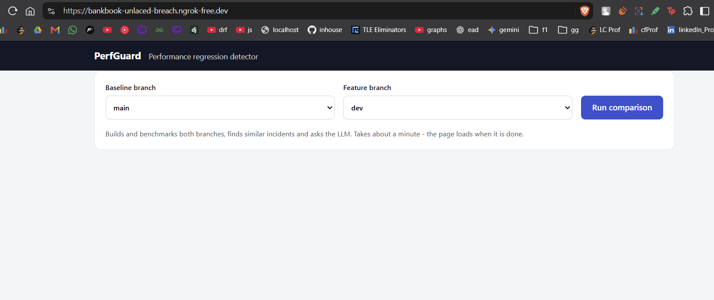
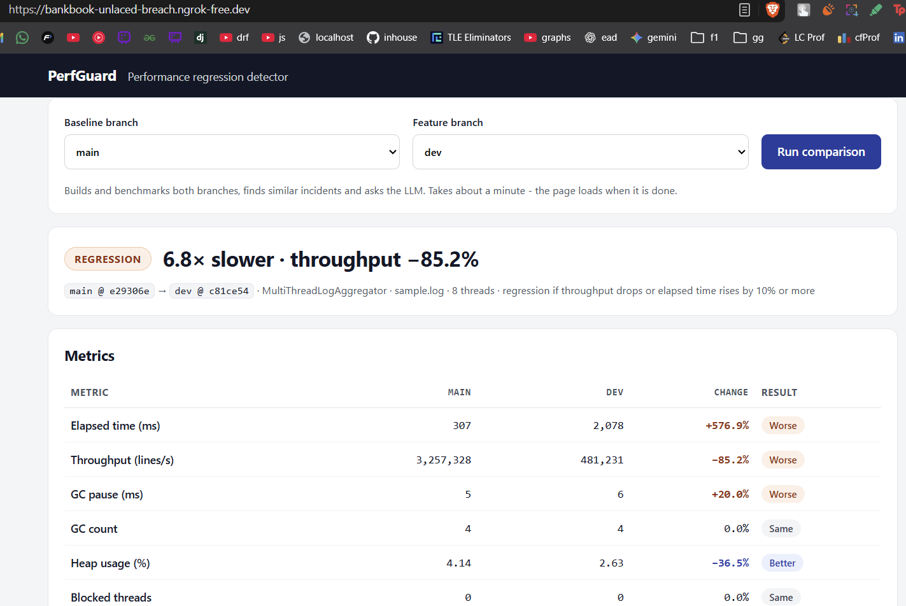
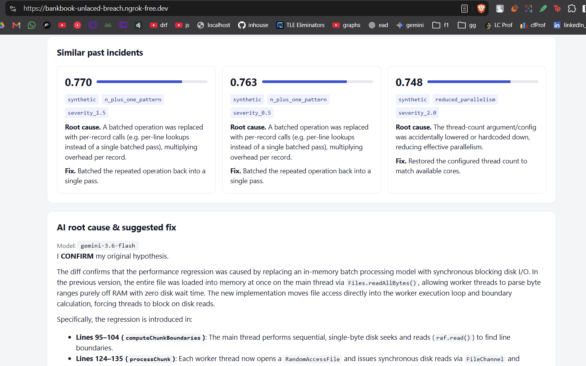
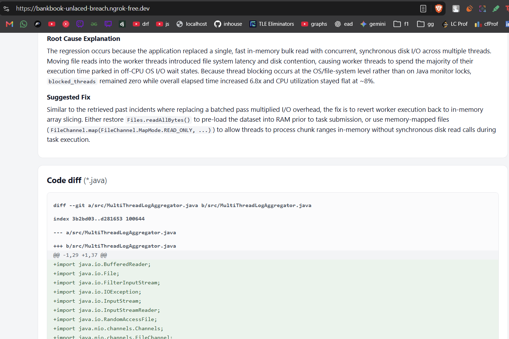
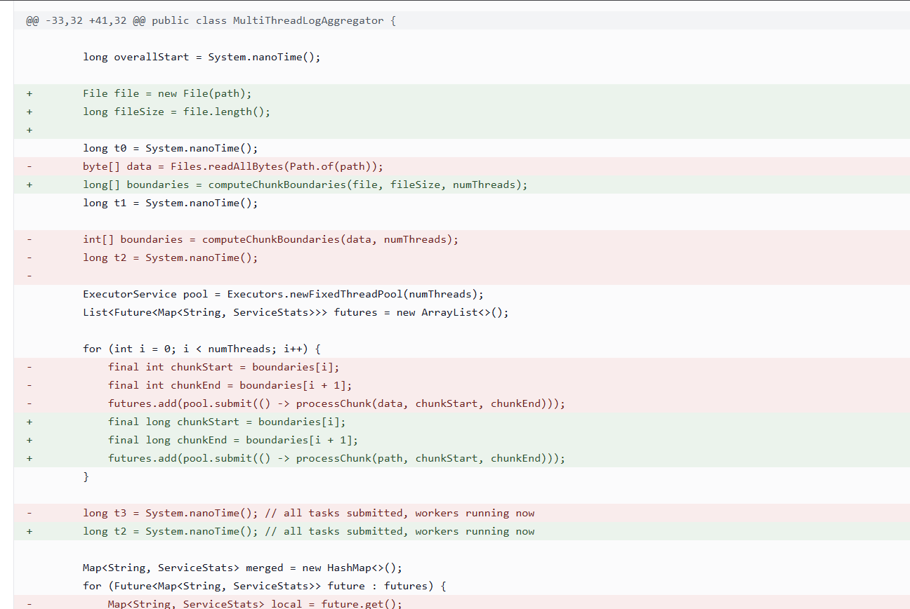

What the project does, in 10 points

1. Compares two git branches of a Java service to catch performance regressions before merging.
2. Builds and runs each branch automatically: checkout, compile, run against a 1M-line log.
3. Collects JVM metrics for each run: elapsed time, throughput, GC pauses and count, heap, thread states and CPU.
4. Turns the change into an 8-number “regression signature” (tanh of each metric’s relative change), so the result doesn’t depend on the machine.
5. Finds similar past incidents in a ChromaDB vector store using cosine similarity, returning the top 3 with their root causes and fixes.
6. Collects the code diff between the branches as evidence.
7. Uses an LLM in two passes: a blind guess from the metrics alone, then a final analysis that confirms, revises or rejects that guess using the diff and the incidents.
8. Gives a root cause and suggested fix that point to specific code, e.g. “per-thread disk reads in processChunk”.
9. Shows everything on one web page: pick branches, press Run, see metrics (worse/better), incidents, the AI explanation and the diff. Built with core Java and plain HTML/CSS.
10. Keeps working without the AI: with no API key, or if the LLM call fails, the metrics, diff and incidents are still shown. Keys stay in a git-ignored .env.

